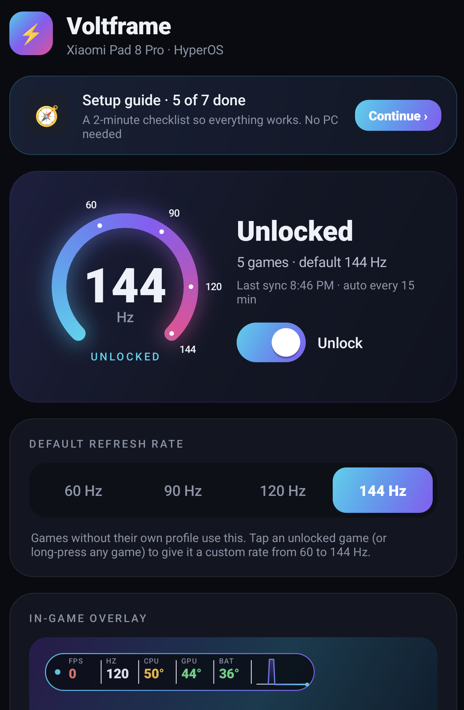
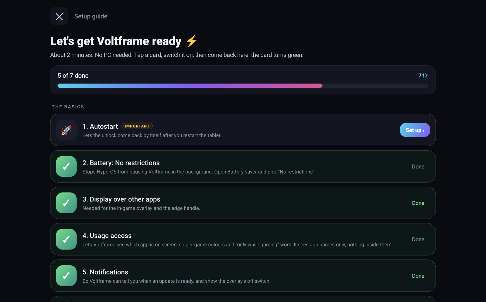

<div align="center">

# ⚡ Voltframe

**Higher refresh rates for games on Xiaomi HyperOS devices. No root needed;
optional extras use a one-time ADB command.**


© 2026 reophyva. All rights reserved.




</div>

---

## The problem

On HyperOS devices with 120/144 Hz screens, many games are held at 60 Hz, even when the system
refresh rate is set higher and the game supports more. Changing display settings doesn't help.

## Why it happens

The limit comes from Xiaomi's **PowerKeeper** system service (`com.miui.powerkeeper`). Games that
Game Turbo detects are held at 60 Hz unless they are on a "high-FPS" list that PowerKeeper accepts
through a broadcast (`com.xiaomi.joyose.HIGH_FPS_LIST`). Voltframe sends your own list of games and
rates to PowerKeeper. Nothing is rooted or patched, and thermal protection keeps working.

## Features

- 🎯 **One-tap unlock** for the games you choose, with a default rate of **60, 90, 120 or 144 Hz**
- 🎮 **Per-game profiles**: a slider from 60 to 144 Hz that snaps to your panel's real refresh modes
  - **Frame advisor** spots *vsync halving* (a game capped at 120 fps runs at 72 on a 144 Hz screen) and suggests a better rate
- ✨ **Auto-adds newly installed games**
- 🔁 **Survives reboots**: re-applies on boot and every 15 minutes
- 🛑 **Off switch**: sends an empty list, so Xiaomi's own limits apply again
- 🎛 **Quick Panel** from a glowing edge handle: brightness, auto-brightness and color profiles
  (🖥 Standard · 🎯 Esports · 🎬 Cinema · 📖 Reading · 🌙 Night · ⚫ E-ink), with per-game profiles that
  switch automatically, plus a memory meter (and Boost on Android 13)
- 📊 **In-game overlay**: FPS + graph, display Hz, CPU / GPU / battery temperature
- ⬆️ **Auto-updates** from this repository's GitHub Releases: signature-checked, one tap to confirm each install (can be turned off)
- 🪶 About 100 KB. No third-party libraries, analytics, ads or accounts. The only network use is the
  update check with GitHub.

## Install

1. Download `Voltframe.apk` from [**Releases**](../../releases/latest).
2. Optional: check it's genuine (see [Is my download genuine?](#is-my-download-genuine) below).
3. Open it with the Files app and allow installing from this source.
4. Open **Voltframe**. Your games are detected and unlocked straight away.
5. Tap **Allow autostart** and **Battery → No restrictions** in the app, so the unlock survives reboots.
6. Close and reopen any game that was already running.

## Is my download genuine?

Every official Voltframe APK is signed with this certificate, and only with this one:

```
SHA-256: 15:B5:21:EE:B6:6D:C8:20:B8:47:28:87:8D:B2:30:A4:84:33:41:04:9C:C4:53:ED:E5:69:22:92:5D:B6:C8:DE
```

**How to check it** (optional, takes a minute):

- **On a PC** with the Android SDK build-tools, or **on the device in Termux** (`pkg install apksigner`), run:
  ```bash
  apksigner verify --print-certs Voltframe.apk
  ```
- Look at the line `Signer #1 certificate SHA-256 digest:`. It must be
  `15b521eeb66dc820b84728878db230a4843341049cc453ede56922925db6c8de`
  (the same number as above, written without colons).
- **If it's different, don't install it.** It isn't from me, even if it's called Voltframe.

Once Voltframe is installed, Android itself refuses any update signed with a different certificate,
and Voltframe's updater checks it again before installing.

## Optional extras (one-time ADB)

| Feature | What it needs |
|---|---|
| Real game FPS + CPU/GPU temperatures in the overlay | `DUMP` permission |
| Cinema, Reading, Night and E-ink color profiles | `WRITE_SECURE_SETTINGS` permission |
| Brightness control | *Modify system settings* (the app opens the right screen) |
| Per-game color switching, *Only while gaming* | *Usage access* (Settings) |

```bash
adb shell pm grant com.reophyva.voltframe android.permission.DUMP
adb shell pm grant com.reophyva.voltframe android.permission.WRITE_SECURE_SETTINGS
```

**What these permissions allow, in plain words**

- **DUMP** lets an app read the diagnostic reports of every Android system service, which can include
  details about notifications, accounts and Wi-Fi. Voltframe only reads frame timing and temperatures,
  keeps nothing, and sends nothing anywhere.
- **WRITE_SECURE_SETTINGS** lets an app change protected system settings, including accessibility
  settings. Voltframe only changes Night Light, Extra dim and Colour correction. It saves your own
  values first, gives them back when you pick **Standard**, **Reset screen** or **Turn off**, and never
  overrides Colour correction that you turned on yourself.

Remove them at any time:

```bash
adb shell pm revoke com.reophyva.voltframe android.permission.DUMP
adb shell pm revoke com.reophyva.voltframe android.permission.WRITE_SECURE_SETTINGS
```

> ⚠️ Turn **USB / Wireless debugging off** again when you're done. Some games and anti-cheat systems
> refuse to run, or may flag your device, while debugging is on.

## Auto-update

Voltframe checks this repository's latest release every 12 hours on Wi-Fi, or when you tap
**Check for updates**. Before installing, it checks that the download is Voltframe, is a newer
version, and is signed with the same certificate as the installed app. Anything else is deleted.
Every update asks you to confirm it with one tap; nothing installs silently. Turn **Auto-update**
off in the app to stop all network use.

## Undo

1. Pick the **Standard** color profile (or tap **Turn off** in the notification). This gives back your
   own Night Light, Extra dim and Colour correction settings.
2. Turn **Unlock** off.
3. Uninstall Voltframe and restart the device.

If the screen still looks tinted or gray: **Settings → Display** (Night Light / Extra dim) and
**Settings → Accessibility → Colour correction**.

## FAQ

**What does it change on my device?** It sends a list of games to Xiaomi's PowerKeeper service and,
only if you use those features, changes brightness and the display color settings above. It doesn't
root or patch the system, and thermal protection stays active.

**Will it hurt battery life?** Higher refresh rates use more power and heat. 120 Hz is a good balance.

**A game runs at 72 fps when I pick 144 Hz.** The game caps itself at 120 fps, so on a 144 Hz screen
vsync halves it. Set that game to 120 Hz; the frame advisor detects this when the overlay is on.

**Why does a game still show 60?** Reopen the game, check its own frame-rate setting, and make sure it's
ticked in Voltframe. Some games cap themselves.

## Privacy

Voltframe collects nothing about you. See [PRIVACY.md](PRIVACY.md).

## Disclaimer

Voltframe is an independent project. It is not affiliated with, endorsed by, or sponsored by Xiaomi,
Epic Games, Microsoft/Mojang, Roblox, Chess.com or any other company. Xiaomi and HyperOS are
trademarks of Xiaomi; all other names belong to their owners and are used only to describe
compatibility.

**Use at your own risk.** Voltframe is provided "as is", without warranty of any kind (see
[LICENSE](LICENSE)). It relies on undocumented HyperOS behaviour that may change or stop working after a
system update. Higher refresh rates use more battery and can make the device warmer.

**Games and anti-cheat.** Voltframe does not modify games, their files or their memory. Some games and
anti-cheat systems react to Developer options / USB or Wireless debugging (needed only for the optional
extras), and some tournaments forbid overlays or screen filters. You are responsible for following each
game's Terms of Service.

## Reporting a device

Open a [device report](../../issues/new?template=device-report.md). Issues are public: don't paste serial
numbers, IMEI, account names or full `dumpsys` output.

## Licence

Proprietary. © 2026 reophyva. All rights reserved. You may use the official APK for personal,
non-commercial use; copying, modifying, decompiling, rebranding or redistributing it is not allowed
without written permission. See [LICENSE](LICENSE).
